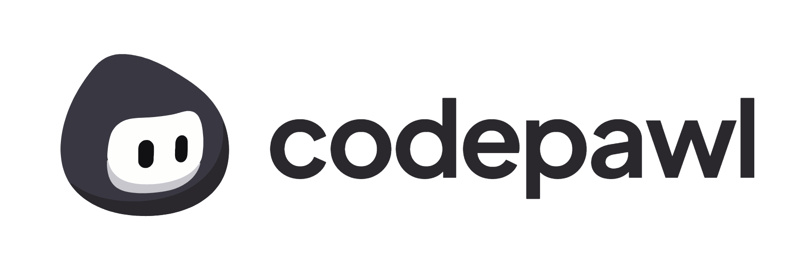

  <a href="https://codepawl.com">
    <picture>
      <source media="(prefers-color-scheme: dark)" srcset="https://raw.githubusercontent.com/codepawl/.github/main/brand/codepawl-lockup-dark.png">
      
    </picture>
  </a>

  
  
  
  
  

A 3D studio in Vietnam. We make worlds and films with AI and share the 3D models and tools behind them
for free.
Each piece is built from real references and checked frame by frame. A canal lock you can run, a steam
spider, a Titanic cut open room by room.

New pieces go up first on [X](https://x.com/anxuanng), on
[Threads](https://www.threads.com/@codepawl) and as films on [YouTube](https://www.youtube.com/@codepawlhq). Free 3D model packs are on
[Hugging Face](https://huggingface.co/codepawl), and our open source tools are pinned below. To commission a piece, go to
[codepawl.com](https://codepawl.com) or write to **[hello@codepawl.com](mailto:hello@codepawl.com)**.

Made something with [Crucible](https://github.com/codepawl/crucible)? Post it in
[Show and tell](https://github.com/codepawl/crucible/discussions/new?category=show-and-tell). We feature picked work on the
[showcase](https://crucible.codepawl.com/showcase.html), with credit.

## Sponsors

Everything we share stays free. [Sponsors](https://github.com/sponsors/codepawl) pay for GPU time, test hardware
and the hours behind it. Backers from $15 a month get their name here, and companies from $100 a month get
their logo.

