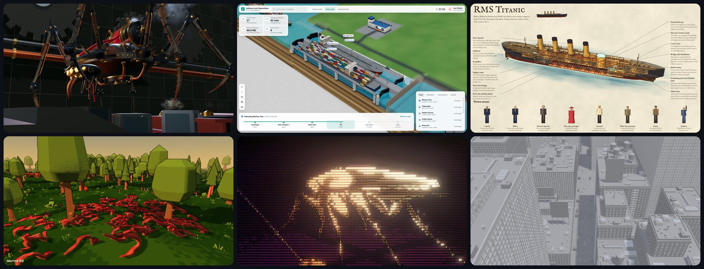

# CodePawl

An AI art studio in Vietnam. We make 3D worlds, films and battles with AI agents, built from real references and
checked frame by frame. A canal lock you can run, a steam spider, a Titanic cut open room by room

New pieces go up first on [X @anxuanng](https://x.com/anxuanng). To commission a piece, go to
[codepawl.com](https://codepawl.com) or write to hello@codepawl.com

## Open source

- **[viz3d](https://github.com/codepawl/viz3d)** is the skill behind most of the work. Your coding agent uses it to
  visualize anything in 3D, as a film, an app, a lesson, a book or a game. It works in Claude Code, Codex, Cursor,
  Gemini CLI and OpenCode
- **[67.js](https://github.com/codepawl/67.js)** is a WebGL2 3D engine that AI agents drive through MCP. viz3d renders
  its films and stills in it. Docs and showcase at [67js.codepawl.com](https://67js.codepawl.com)
- **[spume](https://github.com/codepawl/spume)** is a GPU liquid solver on NVIDIA Warp, with a Blender add-on. We use
  it in place of Mantaflow
- **[oh-snap](https://github.com/codepawl/oh-snap)** takes screen snips on Windows, macOS and Linux. It is written in
  Rust, opens its overlay in 20 ms and is 1.3 MB
- **[simready-glb](https://huggingface.co/datasets/codepawl/simready-glb)** on Hugging Face has all 2,595 NVIDIA
  SimReady models as web-ready glb files. Search and orbit them in the
  [viewer](https://huggingface.co/spaces/codepawl/simready-glb-viewer)

## Closed

Orglet, the AI workers app, its account and router services, and the Tacet models closed in October 2026
